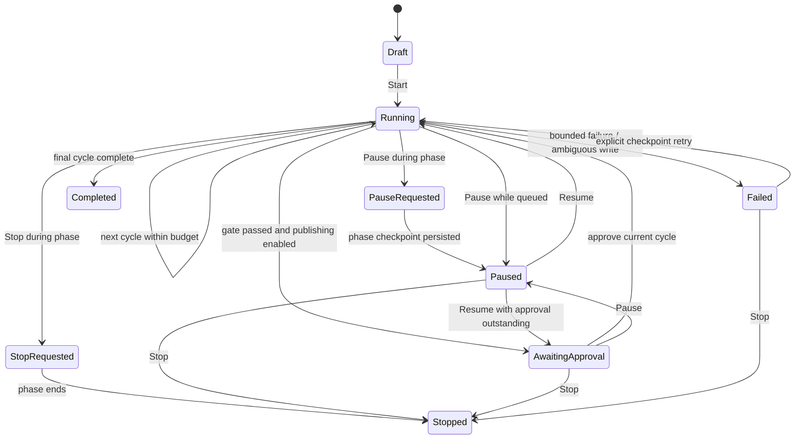

# Architecture — durable control and execution

## 1. Process boundaries

| Component | Responsibility | Can stop without cancelling agent work? |
| --- | --- | --- |
| React UI | Human intent, service controls, history, analysis and progress | Yes |
| API | Validate commands, persist atomic transitions, query MySQL | Yes |
| Core | Models, transaction store, coordinator, runners and workflow | Shared library |
| Worker | Claim persisted phases, renew leases, own CLI process trees | No: recovery rules apply |
| MySQL 8.4 | Authoritative evolution, queue, audit and service state | Outage pauses safe execution |

Core currently links the shared source files under the historical API source
directory; API excludes them from its own compilation. Worker references Core,
not the web executable. The API never registers EventMonitor. Both hosts initialize
the same versioned schema and reject a non-MySQL production provider.

## 2. State machine

Only drafts can be edited; stopped/completed histories are immutable workflow
records unless explicitly deleted. Retry preserves the original phase ID and logs,
increments attempts on the next claim, and adds a human acknowledgement event.
Publish retries require fresh approval. Global dispatch pause is independent of
an individual evolution status and does not kill in-flight CLI work.

## 3. Collaboration contract

One cycle contains scan, plan, one implementation phase per planned item (maximum
five), review, gate and finalization. Each role is a separate Copilot invocation
with a persisted prompt/result and bounded previous-agent context. This is
sequential multi-agent collaboration, not simultaneous writers to one checkout.
Different repositories can be handled by separate Worker processes on the same
machine. Budget (1–50) and cadence are persisted, not browser timers.

The gate must provide strict structured success and command evidence; a natural
language claim alone cannot advance it. Publication requires host policy, saved
evolution opt-in and current-cycle human approval. No automatic merge or force
push. With publication disabled, finalization leaves changes uncommitted locally.

Analyzer stores only a bounded profile (5 MB upload, 1000 rows, 100 columns) and
four role outputs: purpose → insight → direction → summary. Raw row values are
not persisted in profiles. Profile labels/metadata can still be sensitive and
must not be treated as executable instructions. It uses the same durable queue.

## 4. MySQL transactions

Schema version 1:

- `ce_schema`: supported schema marker.
- `ce_evolutions`: ID, version, indexed status/update time, complete JSON aggregate.
- `ce_service`: singleton scheduler state, command audit, heartbeats, repository owners.

All writes lock `ce_service` row 1 with `SELECT ... FOR UPDATE`. Within that short
transaction, the store loads current aggregates, applies a synchronous mutation,
updates changed versions, and commits. No CLI or external I/O runs inside the
transaction. Read transactions obtain consistent snapshots. This intentionally
serializes metadata writes to prevent stale progress from overwriting commands.

Claims atomically reserve the repository, mark one pending phase Processing,
increment attempts, assign a random owner token and a 60-second lease. Only a
Processing phase with the current owner and unexpired lease may append progress,
renew, fail or complete. Completion and its successor enqueue occur in the same
transaction. Ordinary aggregate saves reject stale versions.

Pause/approval/failure retain the repository reservation across phases. Stop or
completion releases it. Paths must identify the same local checkout consistently;
alias/symlink and distributed-host locking are not supported. A local exclusive
file handle guards CLI execution in addition to database ownership.

## 5. Recovery and side effects

- Worker heartbeats and lease renewals run every 10 seconds; UI treats heartbeat
  older than 30 seconds as offline (informational, not proof a process is dead).
- A failed renewal cancels the owned CLI tree; stale output cannot commit.
- Expired read-only phases retry with bounded backoff up to three attempts.
- Interrupted write/review/gate/finalize phases wait for human reconciliation.
- CLI side effects are not transactional with MySQL. No exactly-once guarantee
  for a file edit, commit or push; inspect repository state before Retry.
- Shutdown cleanup uses a bounded independent persistence token; if DB is down,
  expiry recovery handles the saved claim after restart.
- Safety violations require human action even on a normally read-only phase.

## 6. Local security model

The control API accepts loopback clients and a fixed local-origin list. It is not
authenticated for remote use and must not be exposed through a proxy/tunnel.
Dedicated service accounts, trusted repositories, OS filesystem permissions,
least-privilege DB access and controlled CLI credentials remain essential.

Child environments use an allowlist. Read-only roles deny shell/write/edit and
disable builtin MCPs. Post-run Git fingerprint checks detect protected changes;
they do not provide filesystem sandboxing or automatic rollback. Prompt rules
cannot guarantee arbitrary third-party tools obey policies. Do not place secrets
in agent-readable repositories; do not describe this implementation as a sandbox.

## 7. Operational limits and extensions

The UI fetches paged summaries and one selected aggregate with non-overlapping
polls; events have a paginated endpoint. Long selected histories still travel as
one aggregate, and store transactions still read all evolutions. A scalable next
version should split append-only logs/events into indexed tables and stream deltas.
This design favors local correctness, bounded cycles and inspectability over
distributed scaling. No retention deletion happens automatically.

The launcher detaches UI/API/Worker processes; Windows Service deployment adds
boot/logoff survival and failure restart. UI service controls pause/resume dispatch
only. Database backups and repository snapshots must be coordinated before restore.
Legacy imports are idempotent by ID and default to paused/failed with publishing
off. HumanDesign remains human-owned; new design decisions live in Design.