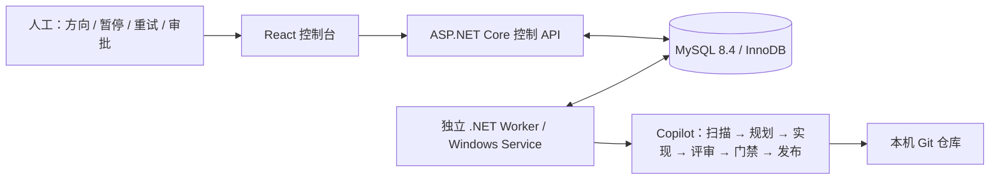

# Code Evolver

**人工离散控制 · 后台持续运行 · 进度完整保存 · 多智能体协作编程**

Code Evolver 将浏览器控制台、控制 API 和执行 Worker 分离。人工保存目标、设定预算、暂停或审批；Worker 通过 GitHub Copilot CLI 持续执行已保存的 Evolution。**关闭 UI 或停止 API 不会停止 Worker。**

## 新架构



- **MySQL 为生产环境唯一存储**，没有静默回退到 JSON；Cassandra 已移除。
- API 不注册执行循环。Worker 单独运行，拥有 CLI 子进程、租约和心跳。
- 保存目标、工作项、每轮阶段、尝试次数、提示词、日志、结果、人工命令和服务状态。
- 每个 Evolution 支持 **1–50 轮**完整协作循环，UI 默认 30 轮；轮间隔可配置。
- 同一仓库跨阶段串行预留，避免协作角色相互覆盖；多个 Worker 可处理不同仓库。
- Analyzer 的四角色分析也走持久化队列，重开 UI 可恢复已保存分析。

详细设计见 [Design/Architecture.md](Design/Architecture.md)，30 项迭代与验收见 [Design/Iterations.md](Design/Iterations.md)。HumanDesign 为人工专属目录，不由智能体修改。

## 准备环境

1. .NET **10 SDK**；Node.js **22.12+**；Git；MySQL **8.4**。
2. 在 Worker 所用的 **同一个操作系统账号**下安装并登录 GitHub Copilot CLI，确保其有仓库、Git 凭据和构建工具权限。仅有 VS Code 扩展登录不代表服务账号的 CLI 已登录。
3. 创建专用数据库 `code_evolver` 和专用数据库账号；授予该库建表、索引和 CRUD 权限。不要使用其他应用数据库或生产凭据。
4. 在本机安全设置环境变量 `ConnectionStrings__CodeEvolver`，包含 Server、Port、Database、User ID、Password 等 MySQL 连接参数。API 和 Worker 必须指向 **同一个库**。不要将连接字符串发到聊天、放到 Git 或命令行参数。

API / Worker 启动时幂等创建版本 1 表结构：`ce_schema`、`ce_service`、`ce_evolutions`。**数据库本身需要提前创建**。网络故障不会转为内存模式。

### 可选本地 MySQL 容器

已有 MySQL 时无需容器。新容器使用回环地址 **3307**，避免占用现有 3306。

先通过本机安全环境设置 `CODEEVOLVER_MYSQL_PASSWORD` 和 `CODEEVOLVER_MYSQL_ROOT_PASSWORD`，再运行：

```powershell
docker compose -f docker-compose.mysql.yml up -d
```

容器库名/账号均为 `code_evolver`；API 连接参数使用 127.0.0.1:3307。数据保存在命名卷中，不要在保留数据时运行 `down -v`。

## 一键启动：独立后台进程 + 控制 UI

在已安全配置数据库环境变量的 PowerShell 中：

```powershell
.\start-code-evolver.ps1
```

脚本构建 UI 和 API，将 UI 作为静态资源托管到 **http://127.0.0.1:5278**，启动独立隐藏 Worker，等待 API 和 Worker 心跳。重复运行可重新打开 UI，不会因为关闭 UI 而终止任务。

选项：

- `-NoBrowser`：不自动打开浏览器。
- `-NoWorker`：只启动控制面，使用已部署的 Worker。
- `-Simulate`：新启动进程使用本地模拟器，不调用 Copilot、不修改仓库、不发布。
- `-DotnetPath`：指定 .NET 10 的完整可执行路径。

日志和进程 ID 位于 Git 忽略的 `.runtime`。若已有进程运行，选项不会重新配置它；更改数据库/模拟模式之前先停止旧进程。隐藏进程不保证注销/重启后存活；需要无人值守时安装 Windows Service。

### 开发模式

分别在三个终端运行（前两个使用相同 MySQL 环境配置）：

```powershell
dotnet run --project src/CodeEvolver.Api --no-launch-profile --urls http://127.0.0.1:5278
dotnet run --project src/CodeEvolver.Worker
cd src/code-evolver-web
npm ci --ignore-scripts
npm run dev
```

开发 UI 为 http://127.0.0.1:5173，Vite 将 `/api` 代理到 5278。生产 UI 同源使用 `/api`；也可通过构建时 `VITE_API_URL` 覆盖。

## Windows 后台服务

```powershell
dotnet publish src/CodeEvolver.Worker -c Release -o publish/worker
```

随后在**用户手动打开的管理员 PowerShell**中执行 [scripts/install-worker-service.ps1](scripts/install-worker-service.ps1)。它在本机凭据对话框中选择专用服务账号，创建自动启动服务并设置失败重启策略；不会自动启动尚未配置的服务。

服务账号需要：

- “作为服务登录”权限、仓库读写权限、构建工具和 Git/Copilot 可执行路径。
- 自己的 Copilot 认证与 Git 凭据。不要使用 LocalSystem 自动代替用户账号。
- 安全提供 MySQL 配置（服务环境，或发布目录中仅服务账号/管理员可读的本地配置）；发布目录不得纳入 Git。
- 可用的 .NET 10 Runtime；用户级 SDK 的路径不会自动成为 Windows 服务环境。

配置后在 Windows Services 启动 `CodeEvolver.Worker`。UI 的 **Pause dispatch / Resume dispatch** 控制调度，不安装、终止或提权启动操作系统服务。UI 关闭、API 关闭和 Worker 停止是三个不同操作。

## 人工控制语义

| 操作 | 持久化行为 |
| --- | --- |
| Create / Edit | 保存目标和策略；只允许编辑尚未启动的 Draft |
| Start | 启动第一轮，重复 Start 不产生重复扫描 |
| Pause | 当前阶段完成后暂停，保留下一阶段；没有执行中阶段则立即暂停 |
| Resume | 从相同检查点继续，不清空历史，不跳过发布审批 |
| Stop | 当前阶段结束后终止，取消剩余队列；保留历史但不可继续，需创建新 Evolution |
| Retry checkpoint | 人工检查部分修改后重试失败阶段，不重新运行已完成阶段 |
| Approve publish | 只批准当前轮的提交、推送和 PR；不会合并 PR |
| Pause dispatch | 全局禁止新认领，正在运行的阶段继续完成；服务/机器重启后仍保持暂停 |

默认 **不发布**：代码变更留在本地工作区。开启发布需在 API / Worker 一致配置 `Agent__Copilot__PublishChanges=true`，创建时勾选发布，并逐轮人工批准。权限限制和提示词不能取代操作系统隔离；只对可信仓库启用无人值守。

每轮：扫描 → 最多 5 项计划 → 每项实现 → 评审 → 门禁 → 最终整理/发布。门禁要求结构化 `passed=true` 和非空实际执行结果；失败或无法运行验证不会进入发布。下一轮会接收本轮已保存成果，但不会清除历史工作项。

## 恢复与一致性

- 60 秒阶段租约，10 秒续租；续租失败会取消当前 CLI 进程树。
- 事务认领 + owner token fencing；旧 Worker 不能提交失效租约结果。
- 只读阶段自动退避重试，最多 3 次。写代码、修复、门禁、发布中断后转 Failed，必须人工核对后重试。
- **不承诺任意 Git/CLI 副作用 exactly-once**。数据库租约不能撤销已经发生的文件修改或推送。
- 同一仓库的 Paused / AwaitingApproval / Failed 任务会保留仓库预留；恢复或 Stop 后才允许另一个 Evolution 接管。Analyzer 同样遵守此限制。
- 进程内文件锁是额外保护；仅支持同一主机上的规范化仓库路径。不要通过符号链接、目录别名或不同主机映射绕过同一个 checkout 的预留。

## 旧数据迁移

先停止旧服务，备份 JSON 或导出 Cassandra 的 evolution JSON 数组，检查仓库路径在新 Worker 上有效：

```powershell
dotnet run --project src/CodeEvolver.Worker -- --import-json C:\backup\evolutions.json
```

导入保留 ID、工作项和日志，跳过已有 ID；运行中记录转暂停，中断执行转失败，发布关闭；导入命令不会启动 Worker。重复导入不会覆盖新数据。旧 Cassandra 驱动/连接不再提供，需先在旧环境导出。

## 测试与验证

```powershell
dotnet test tests/CodeEvolver.Api.Tests --logger trx
cd src/code-evolver-web
npm run build
npm run lint
npm audit
```

真实 MySQL 测试需要本机安全设置 `CODEEVOLVER_TEST_MYSQL`，库名必须以 `code_evolver_test` 开头，服务器必须是 loopback；测试创建并删除唯一临时数据库，未配置时明确 Skip。不得指向真实应用库。

端到端测试 [verify-durable.mjs](src/code-evolver-web/scripts/verify-durable.mjs) 使用独立测试数据库、已构建 Debug API/Worker 和 Edge（可通过 `CODEEVOLVER_BROWSER_CHANNEL` 选择其他已安装 Playwright 浏览器）。设置 `CODEEVOLVER_DOTNET` 可指定 SDK。5278/5173 必须空闲。

```powershell
dotnet build CodeEvolver.slnx
node src/code-evolver-web/scripts/verify-durable.mjs
```

它验证 UI 操作、桌面/移动布局、关闭页面并停止 API 后继续运行、Worker 重启和历史恢复。输出位于 `.runtime/evidence`。**模拟循环通过不代表真实 Copilot 编辑/发布已验证**，CLI 认证、费用、Windows Service 安装需要在目标账号环境验收。

## 运维与安全边界

- API 仅用于可信本机，绑定 loopback，限制 Origin；**没有远程认证，不要通过反向代理、端口转发或隧道公开**。
- CLI 子进程继承最小环境白名单；数据库/控制面密钥不传给 CLI。额外构建变量用 `Agent__Copilot__AllowedEnvironmentVariables` 显式列出。
- 只读角色禁止 shell/write/edit 和内建 MCP；Git 指纹提供修改检测而非沙箱。安全违规不自动重试，不自动回滚用户文件。
- 默认对 GH_TOKEN/GITHUB_TOKEN 脱敏；其他敏感变量应配置 `Agent__Copilot__SecretEnvironmentVariables`。不要让仓库包含可读取的生产秘密。
- Worker 停止时已经写入 MySQL 的进度保留；数据库不可用时不确认新命令。UI 无法连接 API 不等于后台停止。
- 当前存储使用聚合 JSON、短事务和全局调度互斥，适用于本地少量仓库；长历史会增大事务读取量。高规模部署应拆分事件/日志表并归档，当前实现不宣称无限扩展。
- 定期备份专用 MySQL 数据库和目标仓库；恢复时先停 Worker、校验仓库与数据库检查点的一致性，再人工恢复调度。